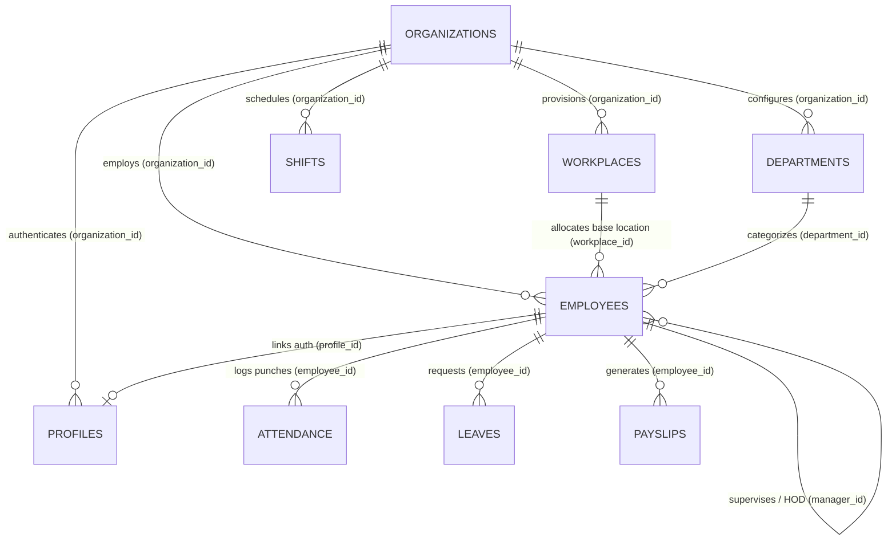

# Firebase Cloud Firestore Database Architecture & Schema Report

**Project ID:** `project-9d1aa`  
**Auth Domain:** `project-9d1aa.firebaseapp.com`  
**Generated Date:** 2026-11-09T17:00:21.574Z  
**Target Primary Tenant Organization:** `shanti-memorial-hospital`  

## 1. Executive Summary & Collection Manifest

| Collection Name | Document Count | Multi-Tenant Key | Primary Tenant (`shanti-memorial-hospital`) Count |
| :--- | :--- | :--- | :--- |
| `organizations` | **6** | `organization_id` | **1** (17%) |
| `workplaces` | **4** | `organization_id` | **3** (75%) |
| `employees` | **622** | `organization_id` | **608** (98%) |
| `profiles` | **706** | `organization_id` | **693** (98%) |
| `departments` | **35** | `organization_id` | **27** (77%) |
| `shifts` | **13** | `organization_id` | **9** (69%) |
| `attendance` | **193** | `organization_id` | **9** (5%) |
| `leave_requests` | **15** | `organization_id` | **0** (0%) |
| `leave_balances` | **213** | `organization_id` | **0** (0%) |
| `leave_types` | **13** | `organization_id` | **6** (46%) |
| `holidays` | **14** | `organization_id` | **0** (0%) |
| `payroll` | **109** | `organization_id` | **0** (0%) |
| `payslips` | **70** | `organization_id` | **0** (0%) |
| `audit_logs` | **1055** | `organization_id` | **570** (54%) |
| `notifications` | **13** | `organization_id` | **0** (0%) |
| `assets` | **12** | `organization_id` | **0** (0%) |
| `goals` | **4** | `organization_id` | **1** (25%) |
| `courses` | **3** | `organization_id` | **0** (0%) |

---

## 2. Multi-Tenant Organization Structure & Unit Hierarchy

### Root Organization: `shanti-memorial-hospital`
- **Organization ID:** `shanti-memorial-hospital`
- **Legal / Display Name:** Shanti Memorial Hospital
- **Active Plan Tier:** `enterprise` (All 20+ modules unlocked)
- **Max Employee Quota:** 1,000
- **Physical Address:** Patia / Thoria Sahi, Manglabag, Cuttack, Odisha 753001
- **Hospital Units / Sub-Brands:**
  1. **Shanti Memorial Hospital** (Main Hospital Campus) — `wp-smh-main` (464 Employees)
  2. **Chikitsa** (OPD & Specialty Centre) — `wp-1793201579968` (111 Employees)
  3. **Gopal Trust** (Trust & Healthcare Outreach) — `wp-1793201564704` (33 Employees)
  4. **Home Health Care (HHC) Unit** (Field & Domiciliary Nursing)
  5. **Main Branch** (Administrative Headquarters)

### Other Tenant Organizations Present in Database:
- `00000000-0000-0000-0000-000000000001` (Subedge Demo Org - 18 Employees)
- `subedge` (Subedge Production Org)
- `chikitsa` (Separate stub org with `parent_organization_id: shanti-memorial-hospital`)
- `gopal-trust` (Separate stub org with `parent_organization_id: shanti-memorial-hospital`)
- `smh` (Legacy alias document)


---

## 3. Detailed Collection Schemas & Field Mappings

### Collection: `organizations` (6 records)

**Organization Distribution:**
- `00000000-0000-0000-0000-000000000001`: 1 records
- `chikitsa`: 1 records
- `gopal-trust`: 1 records
- `shanti-memorial-hospital`: 1 records
- `smh`: 1 records
- `subedge`: 1 records

| Field Name | Inferred Data Type | Sample Value |
| :--- | :--- | :--- |
| `features` | `Object / Map` | `{...}` |
| `plan` | `string` | `enterprise` |
| `updated_at` | `string` | `2026-11-09T16:58:07.305Z` |
| `name` | `string` | `Subedge` |
| `units` | `Array<string>` | `[1 items]` |
| `settings` | `Object / Map` | `{...}` |
| `max_employees` | `number` | `1000` |
| `package_type` | `string` | `enterprise` |
| `parent_organization_id` | `string` | `shanti-memorial-hospital` |
| `created_at` | `string` | `2026-11-03T07:26:25.247Z` |
| `slug` | `string` | `chikitsa` |
| `logo_url` | `string` | `https://www.shantimemorialhospital.com/w` |
| `id` | `string` | `chikitsa` |
| `accent_color` | `string` | `#14B8A6` |
| `primary_color` | `string` | `#0D7377` |

#### Sample Document Preview (`00000000-0000-0000-0000-000000000001`):
```json
{
  "features": {
    "learning": true,
    "performance": true,
    "helpdesk": true,
    "shifts": true,
    "holidays": true,
    "attendance": true,
    "wfh": true,
    "templates": true,
    "biometrics": true,
    "assets": true,
    "leave": true,
    "departments": true,
    "recruitment": true,
    "users": true,
    "locations": true,
    "geofencing": true,
    "directory": true,
    "expenses": true,
    "audit_logs": true,
    "payroll": true
  },
  "plan": "enterprise",
  "updated_at": "2026-11-09T16:58:07.305Z",
  "name": "Subedge",
  "units": [
    "Subedge - Headquarters"
  ],
  "settings": {
    "logo_url": "https://subedge.vercel.app/subedge-logo.png"
  },
  "max_employees": 1000,
  "package_type": "enterprise"
}
```

---

### Collection: `workplaces` (4 records)

**Organization Distribution:**
- `shanti-memorial-hospital`: 3 records
- `subedge`: 1 records

| Field Name | Inferred Data Type | Sample Value |
| :--- | :--- | :--- |
| `address` | `string` | `Manglabag, Thoria Sahi, Cuttack, Odisha ` |
| `latitude` | `number` | `20.46933` |
| `name` | `string` | `Gopal Trust` |
| `id` | `string` | `wp-1793201564704` |
| `is_active` | `boolean` | `true` |
| `radius_meters` | `number` | `500` |
| `created_at` | `string` | `2026-10-28T15:32:44.704Z` |
| `organization_id` | `string` | `shanti-memorial-hospital` |
| `longitude` | `number` | `85.88301` |

#### Sample Document Preview (`wp-1793201564704`):
```json
{
  "address": "Manglabag, Thoria Sahi, Cuttack, Odisha 753001",
  "latitude": 20.46933,
  "name": "Gopal Trust",
  "id": "wp-1793201564704",
  "is_active": true,
  "radius_meters": 500,
  "created_at": "2026-10-28T15:32:44.704Z",
  "organization_id": "shanti-memorial-hospital",
  "longitude": 85.88301
}
```

---

### Collection: `employees` (622 records)

**Organization Distribution:**
- `shanti-memorial-hospital`: 608 records
- `00000000-0000-0000-0000-000000000001`: 14 records

| Field Name | Inferred Data Type | Sample Value |
| :--- | :--- | :--- |
| `organization_id` | `string` | `shanti-memorial-hospital` |
| `employment_type` | `string` | `Regular` |
| `is_hhc_enabled` | `boolean` | `false` |
| `work_email` | `string` | `aniket.rad@shantimemorialhospital.com` |
| `conveyance_allowance` | `number` | `0` |
| `created_at` | `string` | `2026-10-10T11:24:17.695Z` |
| `is_pf_eligible` | `boolean` | `false` |
| `employment_status` | `string` | `active` |
| `manager_id` | `null` | `{...}` |
| `designation` | `string` | `Clinical Staff Member` |
| `bank_details` | `Object / Map` | `{...}` |
| `workplace_id` | `string` | `wp-smh-main` |
| `washing_allowance` | `number` | `0` |
| `default_shift_id` | `string` | `shift-1788794006463` |
| `hospital_unit` | `string` | `Shanti Memorial Hospital` |
| `updated_at` | `string` | `2026-11-03T07:37:53.753Z` |
| `employee_code` | `string` | `SMH-9028` |
| `special_allowance` | `number` | `0` |
| `is_esi_eligible` | `boolean` | `false` |
| `department_id` | `string` | `dept-smh-admin` |
| `phone` | `string` | `9861788990` |
| `onboarding_completed` | `boolean` | `true` |
| `email` | `string` | `aniket.rad@shantimemorialhospital.com` |
| `date_of_birth` | `null` | `{...}` |
| `id` | `string` | `G8vsQlkqjbSSFB6QMtNj` |
| `joining_date` | `string` | `2026-09-12` |
| `tax_config` | `Object / Map` | `{...}` |
| `profile_id` | `string` | `G8vsQlkqjbSSFB6QMtNj` |
| `basic_salary` | `number` | `75000` |
| `grade` | `null` | `{...}` |
| `l1_manager_id` | `null` | `{...}` |
| `hhc_role` | `string` | `supervisor` |
| `l4_manager_id` | `null` | `{...}` |
| `l2_manager_id` | `null` | `{...}` |
| `name` | `string` | `Puspalata Swain` |
| `full_name` | `string` | `Puspalata Swain` |
| `l3_manager_id` | `null` | `{...}` |

#### Sample Document Preview (`G8vsQlkqjbSSFB6QMtNj`):
```json
{
  "organization_id": "shanti-memorial-hospital",
  "employment_type": "Regular",
  "is_hhc_enabled": false,
  "work_email": "aniket.rad@shantimemorialhospital.com",
  "conveyance_allowance": 0,
  "created_at": "2026-10-10T11:24:17.695Z",
  "is_pf_eligible": false,
  "employment_status": "active",
  "manager_id": null,
  "designation": "Clinical Staff Member",
  "bank_details": {
    "bank_name": "",
    "account_number": "",
    "routing_number": ""
  },
  "workplace_id": "wp-smh-main",
  "washing_allowance": 0,
  "default_shift_id": "shift-1788794006463",
  "hospital_unit": "Shanti Memorial Hospital",
  "updated_at": "2026-11-03T07:37:53.753Z",
  "employee_code": "SMH-9028",
  "special_allowance": 0,
  "is_esi_eligible": false,
  "department_id": "dept-smh-admin",
  "phone": "9861788990",
  "onboarding_completed": true,
  "email": "aniket.rad@shantimemorialhospital.com",
  "date_of_birth": null,
  "id": "G8vsQlkqjbSSFB6QMtNj",
  "joining_date": "2026-09-12",
  "tax_config": {
    "esi_exempt": false,
    "socso_percentage": 0.5,
    "pf_number": null,
    "transport_allowance": 0,
    "esi_number": null,
    "tax_regime": "new",
    "hra_amount": 30000,
    "uan_number": null,
    "custom_items": [],
    "epf_percentage": 0,
    "hra_percentage": 40,
    "tax_percentage": 5,
    "tds_percentage": 5
  },
  "profile_id": "G8vsQlkqjbSSFB6QMtNj",
  "basic_salary": 75000,
  "grade": null,
  "l1_manager_id": null
}
```

---

### Collection: `profiles` (706 records)

**Organization Distribution:**
- `shanti-memorial-hospital`: 693 records
- `00000000-0000-0000-0000-000000000001`: 13 records

| Field Name | Inferred Data Type | Sample Value |
| :--- | :--- | :--- |
| `must_change_password` | `boolean` | `false` |
| `organization_id` | `string` | `shanti-memorial-hospital` |
| `is_active` | `boolean` | `true` |
| `id` | `string` | `02rY8JsX1JPjAZ9mDP8scXDhOsL2` |
| `role` | `string` | `employee` |
| `phone` | `null` | `{...}` |
| `full_name` | `string` | `Dr.golam Ahmad` |
| `created_at` | `string` | `2026-11-03T06:54:16.111Z` |
| `email` | `string` | `csmh187@shantimemorialhospital.com` |
| `updated_at` | `string` | `2026-11-05T05:21:43.555Z` |
| `avatar_url` | `null` | `{...}` |
| `needs_password_change` | `boolean` | `false` |
| `is_hhc_enabled` | `boolean` | `true` |
| `session_id` | `string` | `ZxRGDz3h9n8uScA2` |
| `last_login_ip` | `string` | `157.33.42.131` |
| `last_active` | `string` | `2026-10-22T09:11:48.809Z` |
| `hhc_role` | `string` | `field_worker` |
| `biometric_enrolled` | `boolean` | `true` |

#### Sample Document Preview (`02rY8JsX1JPjAZ9mDP8scXDhOsL2`):
```json
{
  "must_change_password": false,
  "organization_id": "shanti-memorial-hospital",
  "is_active": true,
  "id": "02rY8JsX1JPjAZ9mDP8scXDhOsL2",
  "role": "employee",
  "phone": null,
  "full_name": "Dr.golam Ahmad",
  "created_at": "2026-11-03T06:54:16.111Z",
  "email": "csmh187@shantimemorialhospital.com",
  "updated_at": "2026-11-05T05:21:43.555Z",
  "avatar_url": null,
  "needs_password_change": false
}
```

---

### Collection: `departments` (35 records)

**Organization Distribution:**
- `00000000-0000-0000-0000-000000000001`: 8 records
- `shanti-memorial-hospital`: 27 records

| Field Name | Inferred Data Type | Sample Value |
| :--- | :--- | :--- |
| `organization_id` | `string` | `00000000-0000-0000-0000-000000000001` |
| `updated_at` | `string` | `2026-11-08T15:33:56.097Z` |
| `manager_id` | `null` | `{...}` |
| `description` | `string` | `Human Resource` |
| `name` | `string` | `HR` |
| `created_at` | `string` | `2026-11-08T15:33:56.097Z` |
| `id` | `string` | `dept-1794152036097` |

#### Sample Document Preview (`dept-1794152036097`):
```json
{
  "organization_id": "00000000-0000-0000-0000-000000000001",
  "updated_at": "2026-11-08T15:33:56.097Z",
  "manager_id": null,
  "description": "Human Resource",
  "name": "HR",
  "created_at": "2026-11-08T15:33:56.097Z",
  "id": "dept-1794152036097"
}
```

---

### Collection: `shifts` (13 records)

**Organization Distribution:**
- `shanti-memorial-hospital`: 9 records
- `00000000-0000-0000-0000-000000000001`: 4 records

| Field Name | Inferred Data Type | Sample Value |
| :--- | :--- | :--- |
| `is_night_shift` | `boolean` | `false` |
| `id` | `string` | `shift-1788794006463` |
| `organization_id` | `string` | `shanti-memorial-hospital` |
| `name` | `string` | `General Day Shift` |
| `color` | `string` | `#0D7377` |
| `allowance_per_day` | `number` | `0` |
| `start_time` | `string` | `09:00` |
| `end_time` | `string` | `17:00` |
| `created_at` | `string` | `2026-09-07T15:13:26.463Z` |
| `updated_at` | `string` | `2026-09-07T12:10:06.912Z` |
| `grace_period_minutes` | `number` | `15` |
| `break_duration_minutes` | `number` | `60` |

#### Sample Document Preview (`shift-1788794006463`):
```json
{
  "is_night_shift": false,
  "id": "shift-1788794006463",
  "organization_id": "shanti-memorial-hospital",
  "name": "General Day Shift",
  "color": "#0D7377",
  "allowance_per_day": 0,
  "start_time": "09:00",
  "end_time": "17:00",
  "created_at": "2026-09-07T15:13:26.463Z"
}
```

---

### Collection: `attendance` (193 records)

**Organization Distribution:**
- `unassigned`: 30 records
- `shanti-memorial-hospital`: 9 records
- `00000000-0000-0000-0000-000000000001`: 154 records

| Field Name | Inferred Data Type | Sample Value |
| :--- | :--- | :--- |
| `clock_in_latitude` | `number` | `20.29763808869588` |
| `employee_id` | `string` | `L4c4JYqYXD9yZf5SZL0s` |
| `clock_out_latitude` | `null` | `{...}` |
| `updated_at` | `string` | `2026-11-01T12:47:19.853Z` |
| `clock_out_longitude` | `null` | `{...}` |
| `geofence_flagged` | `boolean` | `false` |
| `working_minutes` | `number` | `0` |
| `clock_in_ist` | `string` | `01 Nov 2026, 06:17:19 pm IST` |
| `clock_out_verified` | `boolean` | `false` |
| `clock_in` | `string` | `2026-11-01T12:47:19.853Z` |
| `face_verified` | `boolean` | `true` |
| `clock_in_verified` | `boolean` | `true` |
| `remote_reason` | `string` | `Home Health Care (HHC) Paramedic Visit: ` |
| `date` | `string` | `2026-11-01` |
| `status` | `string` | `present` |
| `clock_in_longitude` | `number` | `85.81362731855069` |
| `geofence_status` | `string` | `Inside` |
| `created_at` | `string` | `2026-11-01T12:47:19.853Z` |
| `is_remote` | `boolean` | `true` |
| `clock_out` | `null` | `{...}` |
| `workplace_id` | `null` | `{...}` |
| `id` | `string` | `L4c4JYqYXD9yZf5SZL0s_2026-11-01` |
| `clock_out_ist` | `string` | `02 Nov 2026, 01:15:11 pm IST` |
| `face_snapshot_url` | `string` | `web_browser_verified` |
| `check_in_time` | `string` | `2026-09-07T08:45:00+05:30` |
| `is_face_verified` | `boolean` | `true` |
| `organization_id` | `string` | `shanti-memorial-hospital` |
| `is_geofence_verified` | `boolean` | `true` |
| `verification_method` | `string` | `biometric_kiosk` |
| `check_out_time` | `null` | `{...}` |
| `shift_id` | `string` | `shift-smh-general` |
| `breaks` | `Array<any>` | `[0 items]` |

#### Sample Document Preview (`L4c4JYqYXD9yZf5SZL0s_2026-11-01`):
```json
{
  "clock_in_latitude": 20.29763808869588,
  "employee_id": "L4c4JYqYXD9yZf5SZL0s",
  "clock_out_latitude": null,
  "updated_at": "2026-11-01T12:47:19.853Z",
  "clock_out_longitude": null,
  "geofence_flagged": false,
  "working_minutes": 0,
  "clock_in_ist": "01 Nov 2026, 06:17:19 pm IST",
  "clock_out_verified": false,
  "clock_in": "2026-11-01T12:47:19.853Z",
  "face_verified": true,
  "clock_in_verified": true,
  "remote_reason": "Home Health Care (HHC) Paramedic Visit: Ayush (Bedridden & Elderly Care) - Geofence: Inside",
  "date": "2026-11-01",
  "status": "present",
  "clock_in_longitude": 85.81362731855069,
  "geofence_status": "Inside",
  "created_at": "2026-11-01T12:47:19.853Z",
  "is_remote": true,
  "clock_out": null,
  "workplace_id": null,
  "id": "L4c4JYqYXD9yZf5SZL0s_2026-11-01"
}
```

---

### Collection: `leave_requests` (15 records)

**Organization Distribution:**
- `unassigned`: 5 records
- `00000000-0000-0000-0000-000000000001`: 10 records

| Field Name | Inferred Data Type | Sample Value |
| :--- | :--- | :--- |
| `reviewed_by` | `null` | `{...}` |
| `employee_id` | `string` | `emp-smh-0008` |
| `updated_at` | `string` | `2026-09-07T16:19:00.272Z` |
| `id` | `string` | `lr-1788797859552` |
| `created_at` | `string` | `2026-09-07T16:17:35.514Z` |
| `reason` | `string` | `demo` |
| `is_half_day` | `boolean` | `false` |
| `approved_by` | `string` | `Ayush Bindhani` |
| `end_date` | `string` | `2026-09-08` |
| `days` | `number` | `2` |
| `start_date` | `string` | `2026-09-07` |
| `reviewed_at` | `null` | `{...}` |
| `status` | `string` | `approved` |
| `leave_type_id` | `string` | `lt-smh-earned` |
| `approval_history` | `Array<Object / Map>` | `[1 items]` |
| `organization_id` | `string` | `00000000-0000-0000-0000-000000000001` |

#### Sample Document Preview (`lr-1788797859552`):
```json
{
  "reviewed_by": null,
  "employee_id": "emp-smh-0008",
  "updated_at": "2026-09-07T16:19:00.272Z",
  "id": "lr-1788797859552",
  "created_at": "2026-09-07T16:17:35.514Z",
  "reason": "demo",
  "is_half_day": false,
  "approved_by": "Ayush Bindhani",
  "end_date": "2026-09-08",
  "days": 2,
  "start_date": "2026-09-07",
  "reviewed_at": null,
  "status": "approved",
  "leave_type_id": "lt-smh-earned"
}
```

---

### Collection: `leave_balances` (213 records)

**Organization Distribution:**
- `unassigned`: 10 records
- `00000000-0000-0000-0000-000000000001`: 203 records

| Field Name | Inferred Data Type | Sample Value |
| :--- | :--- | :--- |
| `year` | `number` | `2026` |
| `used_days` | `number` | `0` |
| `employee_id` | `string` | `INpMmkRRNRcaOTb3jgyI` |
| `allocated_days` | `number` | `10` |
| `updated_at` | `string` | `2026-10-10T14:02:09.441Z` |
| `id` | `string` | `bal_INpMmkRRNRcaOTb3jgyI_lt-smh-casual_2` |
| `leave_type_id` | `string` | `lt-smh-casual` |
| `remaining_days` | `number` | `10` |
| `created_at` | `string` | `2026-09-07T12:13:41.394Z` |
| `organization_id` | `string` | `00000000-0000-0000-0000-000000000001` |

#### Sample Document Preview (`bal_INpMmkRRNRcaOTb3jgyI_lt-smh-casual_2026`):
```json
{
  "year": 2026,
  "used_days": 0,
  "employee_id": "INpMmkRRNRcaOTb3jgyI",
  "allocated_days": 10,
  "updated_at": "2026-10-10T14:02:09.441Z",
  "id": "bal_INpMmkRRNRcaOTb3jgyI_lt-smh-casual_2026",
  "leave_type_id": "lt-smh-casual",
  "remaining_days": 10
}
```

---

### Collection: `leave_types` (13 records)

**Organization Distribution:**
- `00000000-0000-0000-0000-000000000001`: 7 records
- `shanti-memorial-hospital`: 6 records

| Field Name | Inferred Data Type | Sample Value |
| :--- | :--- | :--- |
| `is_paid` | `boolean` | `true` |
| `created_at` | `string` | `2026-09-07T12:10:08.306Z` |
| `name` | `string` | `Annual Leave` |
| `organization_id` | `string` | `00000000-0000-0000-0000-000000000001` |
| `annual_days` | `number` | `18` |
| `id` | `string` | `lt-annual` |

#### Sample Document Preview (`lt-annual`):
```json
{
  "is_paid": true,
  "created_at": "2026-09-07T12:10:08.306Z",
  "name": "Annual Leave",
  "organization_id": "00000000-0000-0000-0000-000000000001",
  "annual_days": 18,
  "id": "lt-annual"
}
```

---

### Collection: `holidays` (14 records)

**Organization Distribution:**
- `00000000-0000-0000-0000-000000000001`: 14 records

| Field Name | Inferred Data Type | Sample Value |
| :--- | :--- | :--- |
| `name` | `string` | `New Year's Day` |
| `date` | `string` | `2026-01-01` |
| `id` | `string` | `hol-2026-01` |
| `type` | `string` | `public` |
| `created_at` | `string` | `2026-09-07T12:10:11.324Z` |
| `organization_id` | `string` | `00000000-0000-0000-0000-000000000001` |
| `is_optional` | `boolean` | `false` |
| `description` | `string` | `Global New Year Holiday` |

#### Sample Document Preview (`hol-2026-01`):
```json
{
  "name": "New Year's Day",
  "date": "2026-01-01",
  "id": "hol-2026-01",
  "type": "public",
  "created_at": "2026-09-07T12:10:11.324Z",
  "organization_id": "00000000-0000-0000-0000-000000000001",
  "is_optional": false,
  "description": "Global New Year Holiday"
}
```

---

### Collection: `payroll` (109 records)

**Organization Distribution:**
- `unassigned`: 52 records
- `00000000-0000-0000-0000-000000000001`: 57 records

| Field Name | Inferred Data Type | Sample Value |
| :--- | :--- | :--- |
| `other_allowances` | `number` | `0` |
| `gross_salary` | `number` | `75000` |
| `special_allowance` | `number` | `20800` |
| `gross_deductions` | `number` | `1800` |
| `employment_type` | `string` | `Regular` |
| `hospital_unit` | `string` | `Shanti Memorial Hospital & Chikitsa Unit` |
| `updated_at` | `string` | `2026-10-23T10:38:04.565Z` |
| `is_pf_eligible` | `boolean` | `true` |
| `total_deductions` | `number` | `1800` |
| `allowances` | `Object / Map` | `{...}` |
| `id` | `string` | `payroll_G8vsQlkqjbSSFB6QMtNj_2025_8` |
| `sl_days` | `number` | `0` |
| `conveyance` | `number` | `1200` |
| `lop_days` | `number` | `0` |
| `created_at` | `string` | `2026-10-23T10:38:04.565Z` |
| `off_days` | `number` | `4` |
| `status` | `string` | `draft` |
| `hra` | `number` | `15000` |
| `net_salary` | `number` | `73200` |
| `basic_salary` | `number` | `37500` |
| `pf` | `number` | `1800` |
| `ot_ded` | `number` | `0` |
| `payroll_period_id` | `string` | `pp_shanti-memorial-hospital_2025_8` |
| `paid_days` | `number` | `30` |
| `cl_days` | `number` | `0` |
| `pt_tds` | `number` | `0` |
| `washing` | `number` | `500` |
| `present_days` | `number` | `26` |
| `lop_amount` | `number` | `0` |
| `leave_days` | `number` | `0` |
| `basic` | `number` | `37500` |
| `pl_days` | `number` | `0` |
| `holiday_days` | `number` | `1` |
| `total_salary` | `number` | `73200` |
| `employee_id` | `string` | `G8vsQlkqjbSSFB6QMtNj` |
| `salary_details` | `number` | `75000` |
| `ot_hours_or_days` | `number` | `0` |
| `deductions` | `Object / Map` | `{...}` |
| `payable_days` | `number` | `30` |
| `esi` | `number` | `0` |
| `ot_amount` | `number` | `0` |
| `ot_hours` | `number` | `0` |
| `tds` | `number` | `0` |
| `is_overtime_eligible` | `boolean` | `false` |
| `lwp_days` | `number` | `0` |
| `organization_id` | `string` | `00000000-0000-0000-0000-000000000001` |

#### Sample Document Preview (`payroll_G8vsQlkqjbSSFB6QMtNj_2025_8`):
```json
{
  "other_allowances": 0,
  "gross_salary": 75000,
  "special_allowance": 20800,
  "gross_deductions": 1800,
  "employment_type": "Regular",
  "hospital_unit": "Shanti Memorial Hospital & Chikitsa Unit",
  "updated_at": "2026-10-23T10:38:04.565Z",
  "is_pf_eligible": true,
  "total_deductions": 1800,
  "allowances": {
    "Special Allowance": 20800,
    "Conveyance Allowance": 1200,
    "HRA": 15000,
    "Washing Allowance": 500,
    "Basic": 37500
  },
  "id": "payroll_G8vsQlkqjbSSFB6QMtNj_2025_8",
  "sl_days": 0,
  "conveyance": 1200,
  "lop_days": 0,
  "created_at": "2026-10-23T10:38:04.565Z",
  "off_days": 4,
  "status": "draft",
  "hra": 15000,
  "net_salary": 73200,
  "basic_salary": 37500,
  "pf": 1800,
  "ot_ded": 0,
  "payroll_period_id": "pp_shanti-memorial-hospital_2025_8",
  "paid_days": 30,
  "cl_days": 0,
  "pt_tds": 0,
  "washing": 500,
  "present_days": 26,
  "lop_amount": 0,
  "leave_days": 0,
  "basic": 37500,
  "pl_days": 0,
  "holiday_days": 1,
  "total_salary": 73200,
  "employee_id": "G8vsQlkqjbSSFB6QMtNj",
  "salary_details": 75000,
  "ot_hours_or_days": 0,
  "deductions": {
    "PT/TDS": 0,
    "PF": 1800,
    "ESIC": 0
  },
  "payable_days": 30,
  "esi": 0,
  "ot_amount": 0
}
```

---

### Collection: `payslips` (70 records)

**Organization Distribution:**
- `unassigned`: 12 records
- `00000000-0000-0000-0000-000000000001`: 58 records

| Field Name | Inferred Data Type | Sample Value |
| :--- | :--- | :--- |
| `file_url` | `null` | `{...}` |
| `period_year` | `number` | `2026` |
| `employee_id` | `string` | `G8vsQlkqjbSSFB6QMtNj` |
| `payslip_number` | `string` | `PS-202610-PAYRO` |
| `id` | `string` | `ps_G8vsQlkqjbSSFB6QMtNj_2026_10` |
| `payroll` | `Object / Map` | `{...}` |
| `created_at` | `string` | `2026-10-28T15:14:36.128Z` |
| `period_month` | `number` | `10` |
| `payroll_id` | `string` | `payroll_G8vsQlkqjbSSFB6QMtNj_2026_10` |
| `organization_id` | `string` | `00000000-0000-0000-0000-000000000001` |

#### Sample Document Preview (`ps_G8vsQlkqjbSSFB6QMtNj_2026_10`):
```json
{
  "file_url": null,
  "period_year": 2026,
  "employee_id": "G8vsQlkqjbSSFB6QMtNj",
  "payslip_number": "PS-202610-PAYRO",
  "id": "ps_G8vsQlkqjbSSFB6QMtNj_2026_10",
  "payroll": {
    "hospital_unit": "Shanti Memorial Hospital & Chikitsa Unit",
    "deductions": {
      "PT/TDS": 0,
      "ESIC": 0,
      "PF": 1800
    },
    "other_allowances": 0,
    "total_deductions": 1800,
    "employee": {
      "updated_at": "2026-10-10T11:24:17.695Z",
      "designation": "Clinical Staff Member",
      "basic_salary": 75000,
      "employee_code": "SMH-9028",
      "profile_id": "G8vsQlkqjbSSFB6QMtNj",
      "organization_id": "shanti-memorial-hospital",
      "onboarding_completed": true,
      "tax_config": {
        "uan_number": null,
        "pf_number": null,
        "esi_number": null
      },
      "department": {
        "organization_id": "shanti-memorial-hospital",
        "name": "Hospital Administration & Directorate",
        "created_at": "2026-09-07T12:59:52.549Z",
        "id": "dept-smh-admin",
        "description": "Medical governance, executive management, and clinical standards"
      },
      "date_of_birth": null,
      "created_at": "2026-10-10T11:24:17.695Z",
      "joining_date": "2026-09-12",
      "department_id": "dept-smh-admin",
      "profile": {
        "role": "employee",
        "id": "G8vsQlkqjbSSFB6QMtNj",
        "created_at": "2026-10-10T11:24:17.695Z",
        "organization_id": "shanti-memorial-hospital",
        "is_active": true,
        "full_name": "Aniket Das",
        "updated_at": "2026-10-10T11:24:17.695Z",
        "email": "aniket.rad@shantimemorialhospital.com"
      },
      "id": "G8vsQlkqjbSSFB6QMtNj",
      "employment_status": "active"
    },
    "gross_deductions": 1800,
    "gross_salary": 75000,
    "special_allowance": 20800,
    "id": "payroll_G8vsQlkqjbSSFB6QMtNj_2026_10",
    "lop_days": 0,
    "esi": 0,
    "leave_days": 0,
    "basic_salary": 37500,
    "off_days": 4,
    "ot_ded": 0,
    "pt_tds": 0,
    "is_pf_eligible": true,
    "lop_amount": 0,
    "paid_days": 30,
    "net_salary": 73200,
    "washing": 500,
    "present_days": 26,
    "employee_id": "G8vsQlkqjbSSFB6QMtNj",
    "conveyance": 1200,
    "created_at": "2026-10-23T08:31:41.012Z",
    "salary_details": 75000,
    "payroll_period_id": "pp_shanti-memorial-hospital_2026_10",
    "basic": 37500,
    "status": "draft",
    "allowances": {
      "HRA": 15000,
      "Washing Allowance": 500,
      "Conveyance Allowance": 1200,
      "Basic": 37500,
      "Special Allowance": 20800
    },
    "payable_days": 30,
    "hra": 15000,
    "ot_hours_or_days": 0,
    "holiday_days": 2,
    "total_salary": 73200,
    "pf": 1800,
    "ot_amount": 0,
    "updated_at": "2026-10-23T08:31:41.012Z"
  },
  "created_at": "2026-10-28T15:14:36.128Z",
  "period_month": 10,
  "payroll_id": "payroll_G8vsQlkqjbSSFB6QMtNj_2026_10"
}
```

---

### Collection: `audit_logs` (1055 records)

**Organization Distribution:**
- `00000000-0000-0000-0000-000000000001`: 485 records
- `shanti-memorial-hospital`: 570 records

| Field Name | Inferred Data Type | Sample Value |
| :--- | :--- | :--- |
| `organization_id` | `string` | `00000000-0000-0000-0000-000000000001` |
| `user_id` | `string` | `URtAoHI5KUNKSw0sJzlmO6smFiH3` |
| `entity_id` | `string` | `URtAoHI5KUNKSw0sJzlmO6smFiH3` |
| `entity_type` | `string` | `auth` |
| `action` | `string` | `USER_SIGN_IN` |
| `created_at` | `string` | `2026-09-07T12:17:42.472Z` |
| `metadata` | `Object / Map` | `{...}` |
| `user` | `Object / Map` | `{...}` |
| `id` | `string` | `act-1788783462472-288` |

#### Sample Document Preview (`act-1788783462472-288`):
```json
{
  "organization_id": "00000000-0000-0000-0000-000000000001",
  "user_id": "URtAoHI5KUNKSw0sJzlmO6smFiH3",
  "entity_id": "URtAoHI5KUNKSw0sJzlmO6smFiH3",
  "entity_type": "auth",
  "action": "USER_SIGN_IN",
  "created_at": "2026-09-07T12:17:42.472Z",
  "metadata": {
    "description": "User Ayush Bindhani (ayushbindhani001@gmail.com) signed in",
    "ip_address": "106.219.179.14",
    "timestamp_ms": 1788783462472,
    "login_method": "password",
    "session_id": "Sw0sJzlmO6smFiH3",
    "platform": "web"
  },
  "user": {
    "full_name": "Ayush Bindhani",
    "role": "admin",
    "email": "ayushbindhani001@gmail.com"
  },
  "id": "act-1788783462472-288"
}
```

---

### Collection: `notifications` (13 records)

**Organization Distribution:**
- `00000000-0000-0000-0000-000000000001`: 4 records
- `unassigned`: 9 records

| Field Name | Inferred Data Type | Sample Value |
| :--- | :--- | :--- |
| `title` | `string` | `Welcome to Oasis Cloud Platform` |
| `organization_id` | `string` | `00000000-0000-0000-0000-000000000001` |
| `message` | `string` | `Your administrative account is live with` |
| `created_at` | `string` | `2026-09-07T12:17:07.521Z` |
| `type` | `string` | `system` |
| `id` | `string` | `notif-1788783427521-0` |
| `action_url` | `null` | `{...}` |
| `is_read` | `boolean` | `false` |
| `profile_id` | `string` | `emp-0001` |

#### Sample Document Preview (`notif-1788783427521-0`):
```json
{
  "title": "Welcome to Oasis Cloud Platform",
  "organization_id": "00000000-0000-0000-0000-000000000001",
  "message": "Your administrative account is live with full security controls and multi-tenant management.",
  "created_at": "2026-09-07T12:17:07.521Z",
  "type": "system",
  "id": "notif-1788783427521-0",
  "action_url": null,
  "is_read": false,
  "profile_id": "emp-0001"
}
```

---

### Collection: `assets` (12 records)

**Organization Distribution:**
- `00000000-0000-0000-0000-000000000001`: 12 records

| Field Name | Inferred Data Type | Sample Value |
| :--- | :--- | :--- |
| `purchase_date` | `string` | `2024-02-15` |
| `category` | `string` | `Laptop` |
| `assigned_to` | `string` | `emp-0001` |
| `asset_tag` | `string` | `OASIS-IT-001` |
| `status` | `string` | `allocated` |
| `id` | `string` | `ast-01` |
| `created_at` | `string` | `2026-09-07T12:16:53.217Z` |
| `organization_id` | `string` | `00000000-0000-0000-0000-000000000001` |
| `name` | `string` | `MacBook Pro 16" (M3 Max, 64GB)` |
| `updated_at` | `string` | `2026-09-07T12:16:53.217Z` |
| `purchase_cost` | `number` | `349900` |
| `serial_number` | `string` | `C02G87Y0MD6R` |

#### Sample Document Preview (`ast-01`):
```json
{
  "purchase_date": "2024-02-15",
  "category": "Laptop",
  "assigned_to": "emp-0001",
  "asset_tag": "OASIS-IT-001",
  "status": "allocated",
  "id": "ast-01",
  "created_at": "2026-09-07T12:16:53.217Z",
  "organization_id": "00000000-0000-0000-0000-000000000001",
  "name": "MacBook Pro 16\" (M3 Max, 64GB)",
  "updated_at": "2026-09-07T12:16:53.217Z",
  "purchase_cost": 349900,
  "serial_number": "C02G87Y0MD6R"
}
```

---

### Collection: `goals` (4 records)

**Organization Distribution:**
- `00000000-0000-0000-0000-000000000001`: 3 records
- `shanti-memorial-hospital`: 1 records

| Field Name | Inferred Data Type | Sample Value |
| :--- | :--- | :--- |
| `id` | `string` | `goal-01` |
| `status` | `string` | `in_progress` |
| `key_results` | `Array<Object / Map>` | `[2 items]` |
| `progress` | `number` | `88` |
| `category` | `string` | `company` |
| `employee_id` | `string` | `emp-1002` |
| `organization_id` | `string` | `00000000-0000-0000-0000-000000000001` |
| `updated_at` | `string` | `2026-09-07T12:17:05.062Z` |
| `department_id` | `string` | `dept-eng` |
| `title` | `string` | `Attain 99.99% Core API Uptime & Multi-Re` |
| `description` | `string` | `Ensure automated failovers, sub-100ms re` |
| `start_date` | `string` | `2026-01-01` |
| `due_date` | `string` | `2026-12-31` |
| `created_at` | `string` | `2026-09-07T12:17:05.062Z` |
| `priority` | `string` | `medium` |
| `target_date` | `string` | `2026-12-31` |

#### Sample Document Preview (`goal-01`):
```json
{
  "id": "goal-01",
  "status": "in_progress",
  "key_results": [
    {
      "title": "Keep p99 API latency below 95ms",
      "target_value": 95,
      "metric": "ms",
      "id": "kr-01",
      "progress": 86,
      "current_value": 82
    },
    {
      "metric": "drills",
      "current_value": 3,
      "title": "Complete disaster recovery drills in Q3",
      "progress": 75,
      "id": "kr-02",
      "target_value": 4
    }
  ],
  "progress": 88,
  "category": "company",
  "employee_id": "emp-1002",
  "organization_id": "00000000-0000-0000-0000-000000000001",
  "updated_at": "2026-09-07T12:17:05.062Z",
  "department_id": "dept-eng",
  "title": "Attain 99.99% Core API Uptime & Multi-Region Cloud Resilience",
  "description": "Ensure automated failovers, sub-100ms response times, and automated database backups.",
  "start_date": "2026-01-01",
  "due_date": "2026-12-31",
  "created_at": "2026-09-07T12:17:05.062Z"
}
```

---

### Collection: `courses` (3 records)

**Organization Distribution:**
- `00000000-0000-0000-0000-000000000001`: 3 records

| Field Name | Inferred Data Type | Sample Value |
| :--- | :--- | :--- |
| `certificate_title` | `string` | `Master Mobile Systems Engineer` |
| `id` | `string` | `course_cloud` |
| `is_mandatory` | `boolean` | `false` |
| `title` | `string` | `Advanced React Native, Skia & Offline-Fi` |
| `enrolled_count` | `number` | `14` |
| `instructor` | `string` | `Marcus Vance (CTO)` |
| `pass_percentage` | `number` | `85` |
| `updated_at` | `string` | `2026-09-07T12:17:02.755Z` |
| `duration_minutes` | `number` | `180` |
| `category` | `string` | `Engineering` |
| `description` | `string` | `Master 60fps animations with React Nativ` |
| `rating` | `number` | `5` |
| `created_at` | `string` | `2026-01-15T00:00:00.000Z` |
| `modules_count` | `number` | `4` |
| `organization_id` | `string` | `00000000-0000-0000-0000-000000000001` |

#### Sample Document Preview (`course_cloud`):
```json
{
  "certificate_title": "Master Mobile Systems Engineer",
  "id": "course_cloud",
  "is_mandatory": false,
  "title": "Advanced React Native, Skia & Offline-First Engineering",
  "enrolled_count": 14,
  "instructor": "Marcus Vance (CTO)",
  "pass_percentage": 85,
  "updated_at": "2026-09-07T12:17:02.755Z",
  "duration_minutes": 180,
  "category": "Engineering",
  "description": "Master 60fps animations with React Native Skia, WatermelonDB SQLite sync, and native module bridges.",
  "rating": 5,
  "created_at": "2026-01-15T00:00:00.000Z",
  "modules_count": 4,
  "organization_id": "00000000-0000-0000-0000-000000000001"
}
```

---

## 4. Entity Relationship Diagram (ERD)



## 5. Hospital Unit Data Linkage Verification

| Hospital Workplace Unit | Workplace ID | Linked Employees | Organization ID | Geofence Coordinates | Radius |
| :--- | :--- | :--- | :--- | :--- | :--- |
| **Shanti Memorial Hospital** | `wp-smh-main` | **464** | `shanti-memorial-hospital` | 20.46933, 85.88301 | 500m |
| **Chikitsa** | `wp-1793201579968` | **111** | `shanti-memorial-hospital` | 13.04030, 80.22957 | 200m |
| **Gopal Trust** | `wp-1793201564704` | **33** | `shanti-memorial-hospital` | 20.46933, 85.88301 | 500m |
| **Total** | - | **608** | `shanti-memorial-hospital` | - | - |

